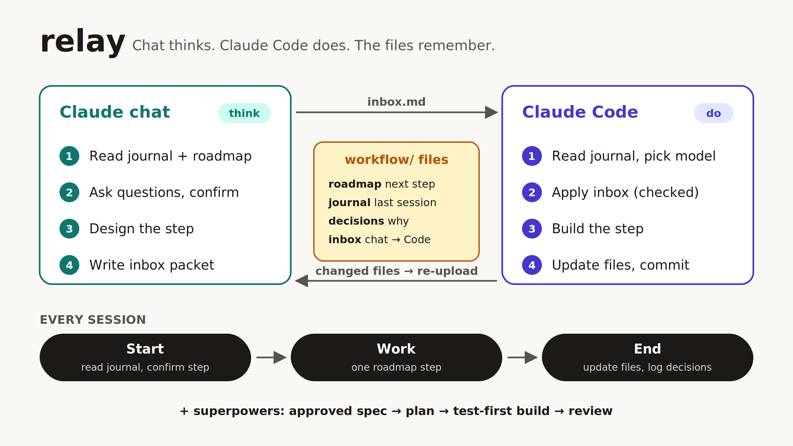
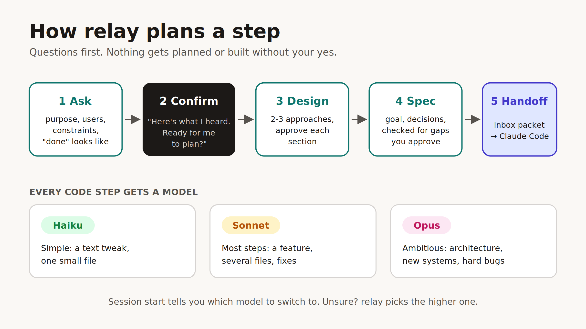
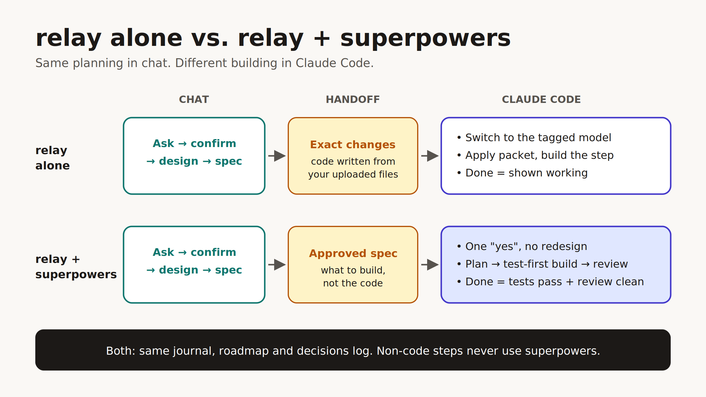

# relay

A Claude skill that gives long projects a memory. Plain markdown files track the plan, progress and decisions, so every session picks up where the last one stopped. Plan in a Claude Project, build in Claude Code.

Works alone or with [superpowers](https://github.com/obra/superpowers).

## What makes it different

- **Chat and Code work together.** Plan in a Claude Project (phone-friendly), build in Claude Code. An inbox file hands work between them.
- **Works with superpowers.** Chat designs, superpowers builds test-first. Built-in rules stop them from clashing.
- **Right model per step.** Code steps are tagged Haiku, Sonnet or Opus.
- **Asks before planning.** Questions first, then your go-ahead, then the plan.
- **Stays on plan.** A roadmap cursor and scope guard stop drift; a decisions log keeps settled questions settled.
- **Keeps the Project in sync.** Each Code session ends by updating your Project's files (or one click on Sync now).
- **Stays lean as the project grows.** The journal and decisions log roll up into archives, applied inbox packets shrink to one line, the index is a snapshot read first, and each roadmap step gets a fresh session.
- **Adapts to you.** Beginners get plain-language explanations; experienced devs don't.

## Install

- **claude.ai:** Settings → Capabilities → turn on code execution. Customize → Skills → + → Upload a skill → `relay.zip`. Also syncs to Claude Code on the same account.
- **Claude Code only:** copy `relay/` to `~/.claude/skills/`.

## Start

In a Claude Project chat or in Claude Code:

> I'm starting a project using the relay skill.

Project instructions to paste (claude.ai → your Project → instructions):

> If instructions.md is in this Project, read it and follow its Session Start Checklist before any work. If it isn't, set up the project with the relay skill.

## How a session works

**Start** (read the journal's last entry, then `index.md`, then only the decisions that touch the step's files; open only the files the step needs; confirm the step and model) → **Work** (one roadmap step) → **End** (update files, log decisions, journal entry, sync the Project, then a reminder to start a fresh session for the next step).

## Planning

## Keeping your Project in sync

Code changes files; chat reads the Project's copies. At the end of each Code session, relay uses the first route that works:

1. **Code session attached to your Project:** uploads the changed files directly.
2. **Repo on GitHub:** pushes, then you click **Sync now** in your Project's files. Link the repo once: Project files → + → GitHub. Include only `CLAUDE.md`, the `workflow/` files (not the two archives) and your specification. A whole-repo sync quickly outgrows the Project and makes chat search snippets instead of reading the files.
3. **Neither:** lists the files to re-upload.

Chat also checks the journal's "Files changed" lines and asks you to sync before writing code against a stale copy.

## Files

| File | Purpose |
|---|---|
| `instructions.md` | Session checklists and rules |
| `roadmap.md` | The plan; `← CURRENT` marks the next step; model tag per code step |
| `journal.md` | Session log; last entry says where to resume and which files changed |
| `decisions.md` | Current rules summary plus the newest decisions; each names the files it touches and what was ruled out |
| `inbox.md` | Chat work waiting for Claude Code |
| `index.md` | Snapshot table of contents; read first on every task |
| `costs.md` | API spend |
| `journal-archive.md` | Older journal entries |
| `decisions-archive.md` | Older decisions |
| `CLAUDE.md` | Loads the rules into every Claude Code session |
| `superpowers.md` | Handoff rules (superpowers users only) |

Chat-only projects need just `instructions`, `roadmap`, `journal`, `decisions` (the archives appear at the first rollup).

The skill itself:

| File | Purpose |
|---|---|
| `relay/SKILL.md` | The jobs relay does day to day: design a step, write an inbox packet |
| `relay/references/setup.md` | Setting up a new project (read once per project) |
| `relay/references/rollups.md` | Rolling up the journal and the decisions log |
| `relay/references/superpowers.md` | Handoff rules for superpowers users |
| `relay/templates/` | The starting copy of every project file |

## Staying token-efficient

Long projects get slow and expensive when every session re-reads a growing pile of files. relay keeps the reading small:

- **Index first.** `index.md` is a snapshot table of contents: one line per file, no history. Every task reads it, picks the files it needs, and opens only those.
- **Decisions by file.** Each decision names the files it `Touches` and what was `Ruled out`. A session reads the short Current rules summary, then only the decisions for its own files, and doesn't retry rejected approaches.
- **Rollups.** The journal keeps its last 3 entries and a one-line summary of the rest; the decisions log keeps its 10 newest entries. Older entries move word for word to archives that sessions open only for history.
- **One-line inbox history.** An applied packet shrinks to one line; git keeps the full text.
- **Short journal entries.** 8 lines of work at most; long evidence goes in a report file.
- **One step per session.** When a step is approved, the session ends and reminds you to start a fresh one. A long session re-reads everything on every message; a fresh one starts from the journal.
- **A lean Project.** Sync only the files chat needs. A whole-repo sync outgrows the Project and makes chat search snippets instead of reading files.
- **Contents lists.** Large reference files, like a specification, open with a list of their headings, so a session reads only the sections it needs.

### Updating an existing project

Projects set up before these changes keep their old `workflow/` files: relay never overwrites them. To bring one up to date, ask in its Claude Project chat: "Write an inbox packet that brings this project's workflow files up to the current relay templates." Then apply the packet in Claude Code.

## With and without superpowers

| | Without | With |
|---|---|---|
| Design | Chat | Chat |
| Handoff | Inbox packet with exact changes | Inbox packet with an approved spec |
| Build | Claude Code, step by step | Superpowers: plan, test-first build, review |
| Mid-build questions | Stops to ask | Decides, logs the call |
| Done means | Shown working | Tests pass + review clean |
| Model per code step | Tagged Haiku/Sonnet/Opus; you switch | Superpowers picks |
| Non-code steps | relay | relay |
| Rules per session | ~2,450 tokens | ~3,950 tokens |

Design method adapted from superpowers' brainstorming skill. Decisions' Touches and Ruled out lines adapted from [Trail-Code](https://github.com/trailhq/Trail-Code)'s learnings.

## Changes

**2026-10-17 — Token efficiency.** Main skill file cut from 11.3 KB to 5.3 KB (setup and rollups moved to `references/`). New: decisions summary and rollup with `decisions-archive.md`, Touches and Ruled out lines on decisions, one-line inbox history, index as a snapshot read first, journal entries capped at 8 lines, Contents lists for large reference files, one step per session with a new-session reminder, and guidance to sync only the files chat needs. The per-session rules grow by about 750 tokens; on a large project, the reading at the start of each session fell from about 60–100K tokens to about 25–30K.
